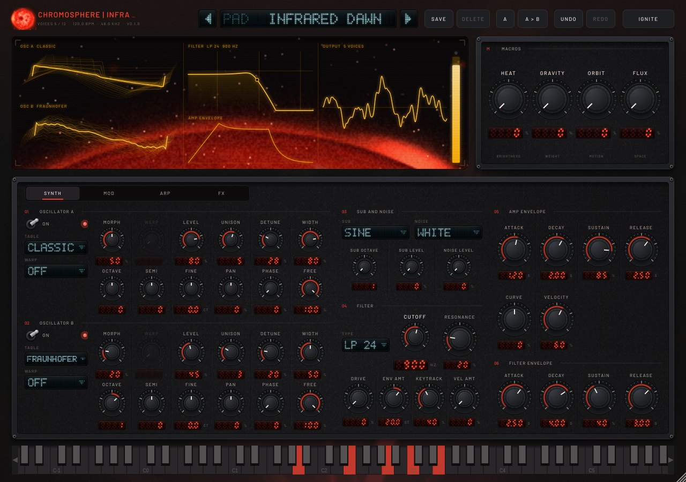
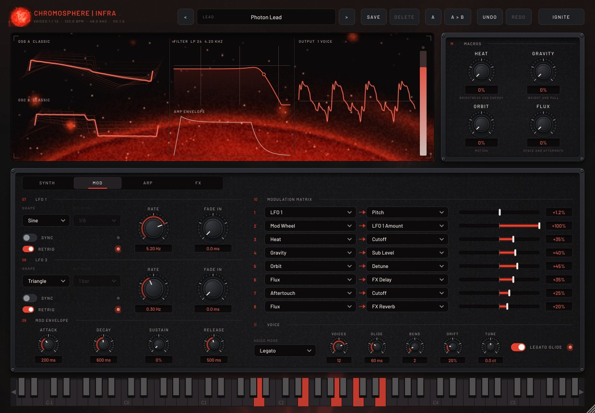
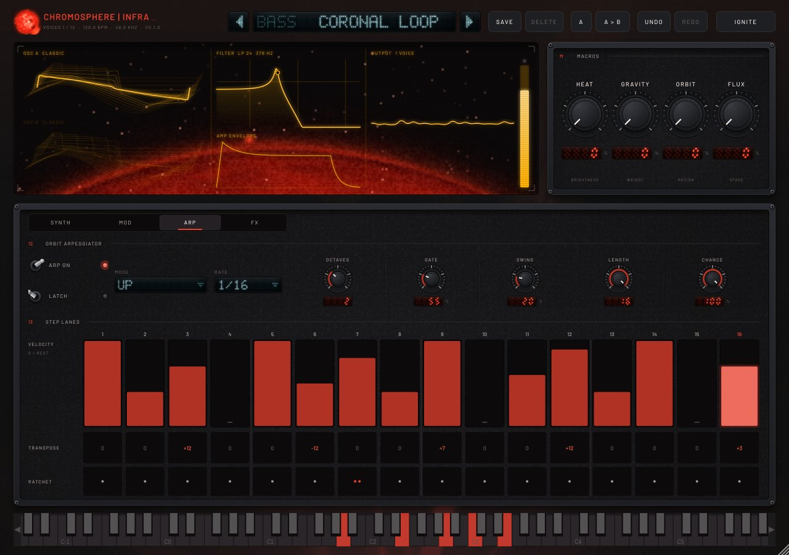
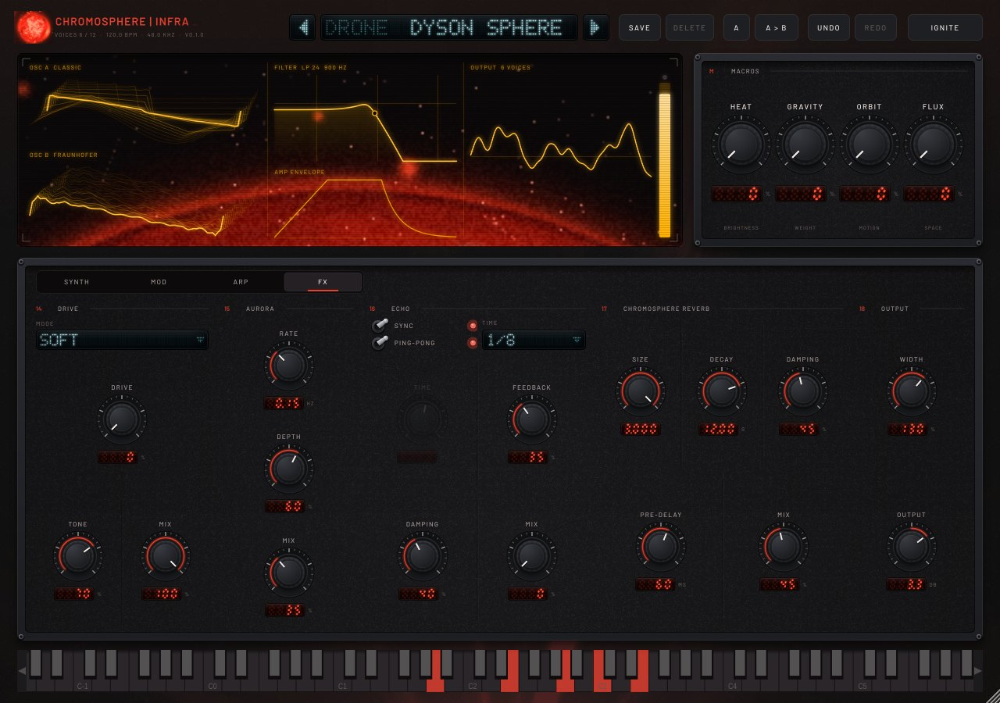
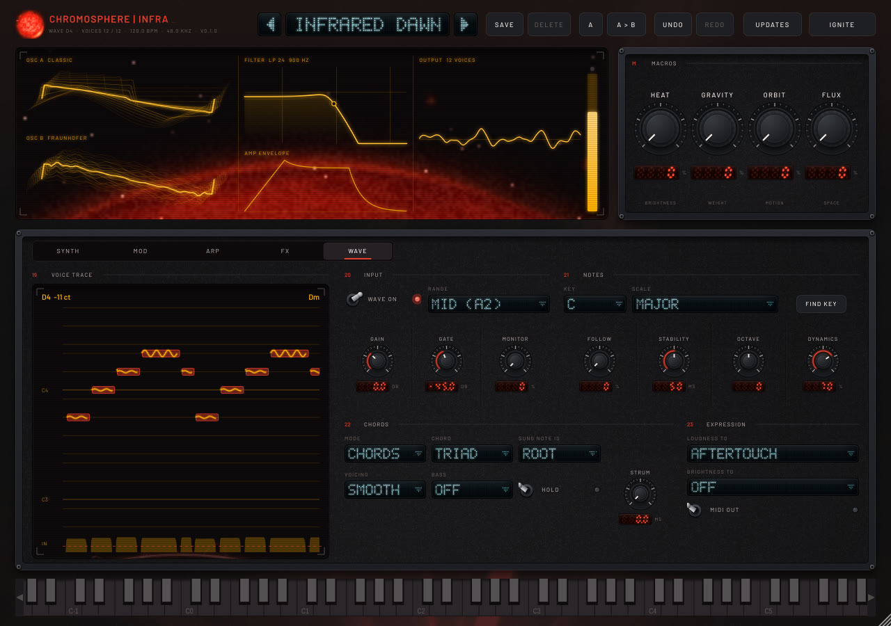

# Chromosphere | INFRA

The instrument in the Chromosphere family. EXO is the reverb; INFRA is the same star seen in infrared. It's a
polyphonic wavetable synthesizer with a step arpeggiator, a modulation matrix, four universal macros and an
effects rack that ends in the Chromosphere reverb engine itself. See `docs/PRD.md`.

| | |
|---|---|
|  |  |
|  |  |

## What is in it

- **Oscillators A and B**: ten generated spectral tables (Classic, Fraunhofer, Pulsar, Nebula, Ion Drive, Magnetar,
  Plasma, Event Horizon, Dark Matter, Quasar), 16 frames each, band-limited at 11 levels with no aliasing (a
  5 kHz saw is 66 dB clean). Each has Morph, unison up to 8 with detune and width, and the warps Bend, Mirror,
  Quantize, FM from B and Ring by B. A sub oscillator and four noise colours (White, Pink, Solar Wind, Crackle) sit
  alongside.
- **Filter**: LP 24 (ZDF ladder), LP 12, BP 12, HP 12, HP 24, Notch, Comb, Formant, with drive, envelope, key and
  velocity amounts.
- **Modulation**: amp, filter and mod envelopes; two LFOs with tempo sync, fade-in and the Drift and S&H shapes;
  an 8-slot matrix with 18 sources and 26 destinations. Those include LFO Amount (mod-wheel vibrato) and the
  effect sends.
- **Four macros with a fixed meaning in every preset**: HEAT (brightness and energy), GRAVITY (weight and pull),
  ORBIT (motion) and FLUX (space and aftermath).
- **Orbit arpeggiator**: Up, Down, Up/Down, Down/Up, As Played, Random, Converge, Diverge, Chord, Orbit and Pulsar
  modes. It has a 16-step lane of velocity (0 is a rest), transpose and ratchet, plus swing, latch and step
  probability, and syncs to the host transport.
- **Effects**: Drive (Soft, Tube, Fold, Cosmic Ray), the Aurora chorus, the Echo ping-pong delay, the Chromosphere
  reverb (the EXO FDN engine through its thread-safe host), then width, output and a peak limiter.
- **442 factory presets** in 15 categories, each designed individually (`tools/make_presets.py` and the
  `tools/presets_*.py` library files; `tools/check_presets.py` validates a file on its own). Bass and Lead hold the
  originals plus redesigned "II" versions and new types (808, neuro, wobble, reese, hoover, trance supersaw, sync,
  hardstyle and more); Chords and Melody are categories of their own. Every preset uses the four macros, the mod
  wheel and aftertouch. Levels are calibrated by measurement to within about 0.4 dB. `tools/infra_audition` renders
  presets with a bass, lead, chord or melody phrase and `tools/audition_metrics.py` measures them.
- **Effects for bass and lead work:** Drive *Sub clean* (only what is above it is driven), *Squash* (OTT-style
  three-band compression) and *Low mono* (no stereo below it).
- **Ignite** builds a new patch from rules for a chosen sound type (bass, lead, pad, pluck, keys, arp, drone or FX).
- **Interface** in the EXO design language, in red: matte instrument bays with bolts, knurled dials with lit arcs
  that pulse with the bass, red seven-segment readouts, lever switches, and a cyan VFD preset selector and combos.
  An amber CRT scope (wavetables, filter response, envelope, output) sits over the rising limb of a live red sun.
- **Per-note pitch (VST3 note expression):** INFRA advertises a Tuning note expression, so hosts that send per-note
  pitch to VST3 instruments (FL Studio slide notes and per-note bends, Cubase/Nuendo expression, Bitwig) bend each note
  on its own, chords included. Channel pitch bend works as usual (range: Bend, on the Mod page). It needs a small JUCE
  patch, `cmake/juce-vst3-input-events.patch`, which the build applies automatically.
- **WAVE: play it with your voice** (`../wave/README.md`). Sing, hum or whistle into INFRA's audio input ("WAVE In";
  in the standalone app, the microphone) and the voice plays the synth: the melody, snapped to a key if you like,
  or a chord in the key for each sung note (8 chord types, melody on top, smooth voice leading, bass, strum, hold),
  with loudness as velocity and aftertouch and Follow carrying vibrato and slides as per-note tuning. Find key
  listens and sets the key. MIDI out sends the same notes on, so the standalone app can play other instruments
  through a loopback MIDI port. WAVE settings are not part of presets.
- An on-screen keyboard, user presets, A/B, undo and redo. Any window size from 1180 x 820 to 1900 x 1300.

## Build

INFRA builds with the rest of the repository (it reuses the reverb's `frdsp` and `frhost`):

    cmake -S . -B build && cmake --build build -j --target infra_tests infra_bench
    build/infra/infra_tests            # DSP: tables, aliasing, voices, sustain, arp timing, block sizes, rates
    build/infra/infra_bench            # CPU: 16 voices x 2 osc x 4 unison with all effects

    cmake -S . -B build-plugin -DFR_BUILD_PLUGIN=ON [-DFR_JUCE_DIR=/path/to/JUCE]
    cmake --build build-plugin -j --target ChromosphereInfra_VST3 infra_plugin_smoke infra_preset_render infra_editor_snapshot
    build-plugin/infra/infra_plugin_smoke        # parameters, state, Ignite, mono bus, fuzzing, user presets
    build-plugin/infra/infra_preset_render       # renders every factory preset and checks it
    xvfb-run -a build-plugin/infra/infra_editor_snapshot out/   # PNGs of the editor

Presets: edit `tools/make_presets.py` and run it to rewrite `data/presets.json`. To recalibrate levels, run
`infra_preset_render --measure measured.json`, then `python3 tools/make_presets.py --calibrate measured.json`, and
repeat two or three times.

## Windows: install, update, release

- **Download:** `ChromosphereInfra-Setup.exe` from the repository's **infra-nightly** release
  (`https://github.com/ChrispyBiscuit/chromosphere/releases/download/infra-nightly/ChromosphereInfra-Setup.exe`).
  It installs the VST3 plug-in to `C:\Program Files\Common Files\VST3` and the standalone app to
  `C:\Program Files\Chromosphere INFRA` (Start menu entry, optional desktop shortcut). Each part can be left out.
  The zip next to it holds the same files for manual installation.
- **Standalone app:** plays without a DAW. Options > Audio/MIDI Settings selects the audio device and the MIDI
  keyboard; the on-screen keyboard plays too.
- **Updates:** the plug-in and the app check once a day (one small `latest.json` from the same release). When a
  newer version is out, the header's Updates button turns red. Click it, then **Install now**: the installer is
  downloaded, its SHA-256 is checked against the manifest, and it installs silently as soon as the DAW or the app
  closes (the app reopens itself afterwards). With **Install new versions automatically** on, this happens without
  asking. Both are settings in the same panel; the daily check can be turned off.
- **Releasing:** every push runs CI. The Windows job stamps version `0.1.<run number>`, builds and tests, runs
  pluginval at strictness 10 and builds the Inno Setup installer (`installer/ChromosphereInfra.iss`). The
  `release-infra` job then republishes the infra-nightly release with the installer, the zips and a fresh
  `latest.json`. That is what every installed copy updates to. The tag is separate from EXO's `nightly`.
- **Not code-signed:** Windows SmartScreen shows "Windows protected your PC" the first time (More info > Run
  anyway). Signing needs a code-signing certificate; with one, add a `signtool` step before the release job.
- Tests for the update path: `infra_updater_test` serves a local manifest and installer and checks version
  comparison, download, checksum verification and the rejection of a tampered file.

## Status

- Linux: everything builds (VST3 and standalone); all tests pass; the editor was checked from snapshots.
- Windows (MSVC, installer) and macOS (AU, app): built by CI.
- CPU: the worst case above uses about 15-16% of one core on a 2.8 GHz cloud VM, near the PRD's 15% target
  (which assumes a desktop CPU).
