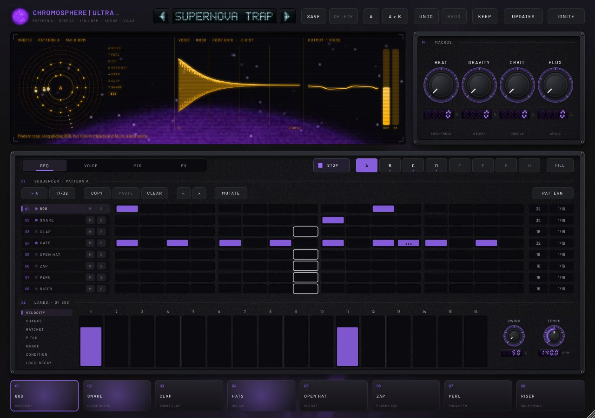
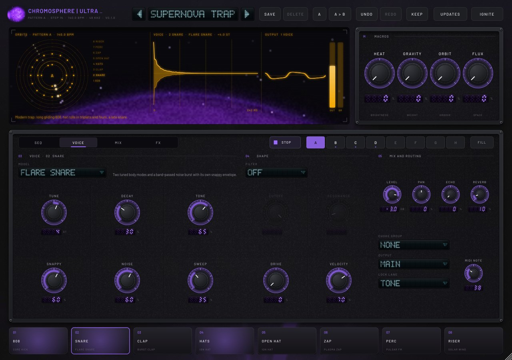
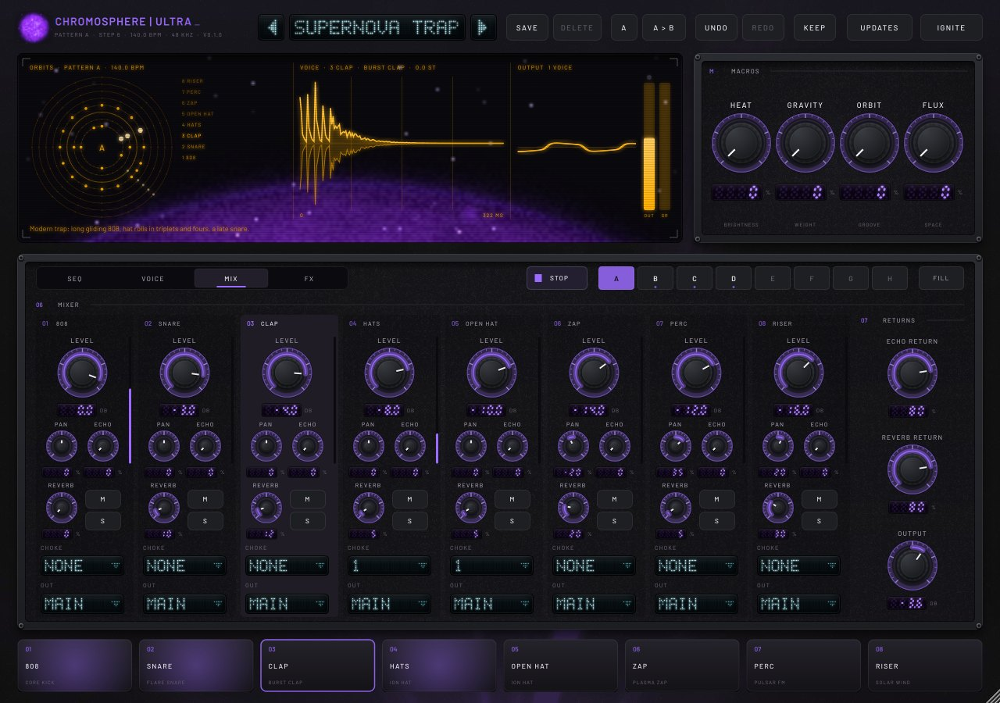
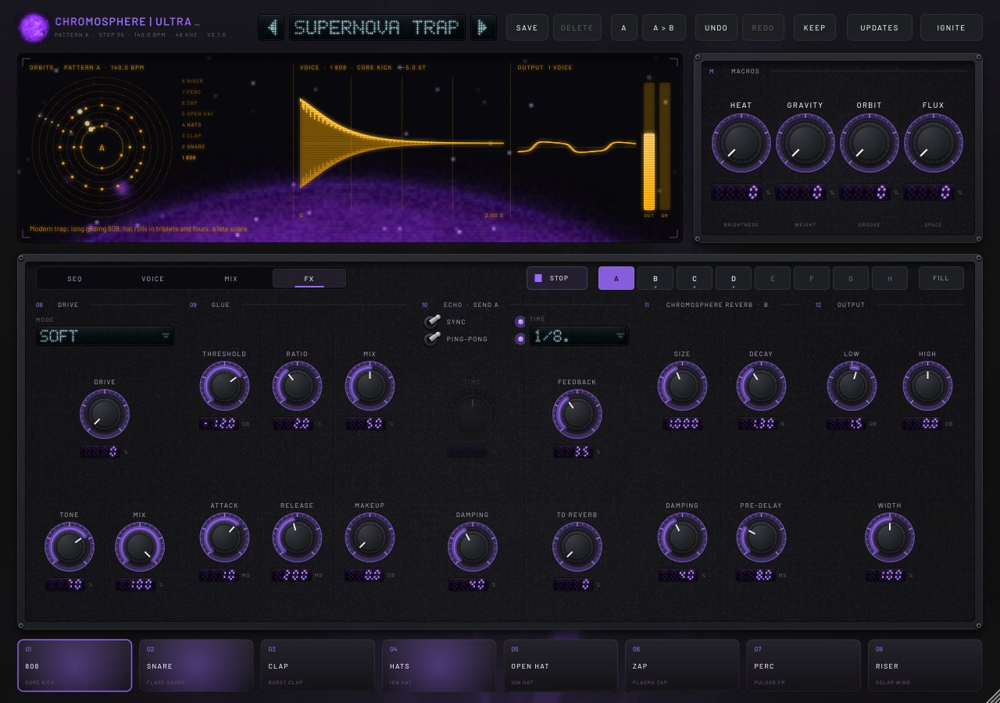

# Chromosphere | ULTRA

The drum machine in the Chromosphere family. EXO is the reverb, the sun in visible light; INFRA is the synthesizer,
the same star in infrared. ULTRA is the star in ultraviolet, where it is all flares and sharp bursts of energy. It is
an eight-track synthesized drum machine with a step sequencer, a mixer and a master bus that ends in the Chromosphere
reverb engine itself. See `docs/PRD.md`.

| | |
|---|---|
|  |  |
|  | |

## What is in it

- **Thirteen drum models**, all synthesized: Core Kick (analog), Gravity Kick (FM), Flare Snare, Burst Clap, Ion Hat
  (the 808's six metallic squares), Corona Cymbal, Orbit Tom, Pulsar FM, Quasar Metal (cowbell to bell), Spark Rim
  (rimshot and clave), Solar Wind (noise: shakers, risers), Plasma Zap and Nebula Modal (a six-mode resonator:
  membrane, bar, glass). Every model reads the same six dials (Tune, Decay, Tone, Snap, Color, Sweep); the VOICE page
  names them for the model in use. Each track adds drive, a filter (INFRA's eight types), velocity sensitivity,
  level, pan, two sends, a choke group, a MIDI note and an output.
- **Sequencer**: 8 patterns (A..H), up to 32 steps per track, a length and a rate per track (1/32 to 1/4,
  triplets, dotted 1/16), so tracks can run in polymeter. Each step has velocity, chance, ratchet, pitch, nudge
  (micro-timing), a trig condition (Fill, Not fill, 1st, A:B ...) and a lock of one chosen parameter. Swing and
  humanize. It follows the host's song position, so loops and bounces repeat exactly; the Play button runs it
  while the host is stopped and in the standalone app. Pattern changes wait for the bar line. MIDI notes C0..G0
  pick patterns A..H.
- **Mixer**: mute, solo, choke groups (closed hat cuts open hat), two sends, and 8 optional stereo aux outputs.
- **Master bus**: Drive (Soft, Tube, Fold, Cosmic Ray, from INFRA), a glue compressor, the Echo and the Chromosphere
  reverb (EXO's FDN engine through its thread-safe host) as send effects, low and high shelves, width, output, a DC
  blocker and a peak limiter.
- **Four macros with a fixed meaning on every kit**, the same names as INFRA: HEAT (brightness), GRAVITY (weight),
  ORBIT (groove: swing, humanize, lock depth) and FLUX (space).
- **108 factory presets** in 12 genre categories (plus Init), each a kit with four patterns: main, variation, break and
  fill (`tools/make_presets.py`). Levels are calibrated by measurement to about -15 dBFS. They have not been
  auditioned by ear yet. Each genre has two or three groove sets that its presets share; the kits differ per preset.
- **Ignite** builds a new kit and four patterns from the rules of a genre (House, Techno, Hip-Hop, Trap, Drum & Bass,
  Breakbeat, Electro, Experimental).
- **Interface** in the family design language, in ultraviolet: the step grid with mute and solo lamps, the lane
  editor, eight pads that light with each hit, an amber CRT scope over the rising violet limb of a live sun (an
  orbit radar where each track's ring turns at its own speed, the selected voice's rendered hit, the output and
  glue gain reduction), seven-segment readouts, lever switches and a cyan VFD preset selector. User presets
  (patterns included), A/B, undo and redo for parameters and step edits, "Keep" to load a kit under the current
  patterns. Any window size from 1180 x 820 to 1900 x 1300.

## What it borrows

From the reverb (`main`): the FDN engine and `fr::EngineHost`, unchanged. From INFRA: the DSP blocks (filter, SVF,
drive, echo, reverb stage, limiter), the look and feel, live sun, wordmark, VFD, seven-segment readouts, widgets,
preset manager, updater, installer and tests, with INFRA's UI performance fixes (`infra/docs/RCA-ui-performance.md`
on the INFRA branch) applied from the start. The details are in `docs/PRD.md` Section 2.

## Build

ULTRA builds with the rest of the repository (it reuses the reverb's `frdsp` and `frhost`):

    cmake -S . -B build && cmake --build build -j --target ultra_tests ultra_bench
    build/ultra/ultra_tests            # models, aliasing, sequencer timing, conditions, chance, choke, routing, block sizes, rates
    build/ultra/ultra_bench            # CPU: 8 tracks on 1/32 ratchets, long tails, every effect

    cmake -S . -B build-plugin -DFR_BUILD_PLUGIN=ON [-DFR_JUCE_DIR=/path/to/JUCE]
    cmake --build build-plugin -j --target ChromosphereUltra_VST3 ultra_plugin_smoke ultra_preset_render ultra_editor_snapshot
    build-plugin/ultra/ultra_plugin_smoke        # parameters, patterns, state, undo, pads, MIDI, mono and multi-out, Ignite, fuzzing, user presets
    build-plugin/ultra/ultra_preset_render       # renders every factory preset and checks it
    xvfb-run -a build-plugin/ultra/ultra_editor_snapshot out/ ["Preset name"]   # PNGs of the editor

Presets: edit `tools/make_presets.py` and run it to rewrite `data/presets.json`. To recalibrate levels, run
`ultra_preset_render --measure measured.json`, then `python3 tools/make_presets.py --calibrate measured.json`, rebuild,
and repeat two or three times. Images: `tools/make_uv_assets.py` derives the violet sun images and icons from EXO's.

## Windows: install, update, release

- **Download:** `ChromosphereUltra-Setup.exe` from the repository's **ultra-nightly** release
  (`https://github.com/ChrispyBiscuit/chromosphere/releases/download/ultra-nightly/ChromosphereUltra-Setup.exe`).
  It installs the VST3 plug-in to `C:\Program Files\Common Files\VST3` and the standalone app to
  `C:\Program Files\Chromosphere ULTRA`. The zip next to it holds the same files for manual installation.
- **In FL Studio**: add it to the Channel rack as a generator; the sequencer follows FL's transport. For multi-out,
  enable the aux outputs in the wrapper and set a track's Output to Aux 1..8.
- **Updates** work as in INFRA: a daily check of one small `latest.json`, Install now from the Updates button, or
  automatic install when the DAW closes. The tag is separate from EXO's `nightly` and INFRA's `infra-nightly`.
- **Not code-signed:** Windows SmartScreen warns the first time (More info > Run anyway).

## Status

- Linux: everything builds (VST3 and standalone); all tests pass (DSP, plugin smoke, all 109 presets, updater);
  pluginval at strictness 10 passes; the editor was checked from snapshots at 1180 x 820, 1280 x 900 and 1700 x 1150.
- CPU: the benchmark's worst case uses about 6-7% of one core on a cloud VM (PRD gate: 10%).
- Windows (MSVC, installer, pluginval) and macOS (AU, app): set up in CI (`.github/workflows/build.yml`, jobs
  `ultra-windows`, `ultra-macos`, `release-ultra`); they have not run yet.
- Not yet heard: the models are level-matched and checked by measurement, and the presets by render checks, but
  nobody has listened to them. Expect sound design passes after a first listen.
